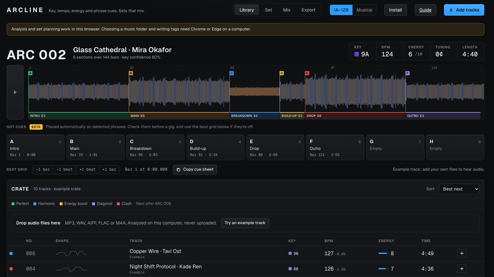
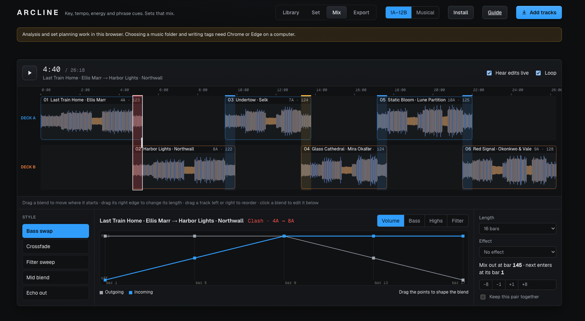

# ARCLINE

A crate is full of possible journeys. ARCLINE reads the key, tempo, energy, and phrasing in each track, then helps you find a route from warm-up to peak time. It runs in your browser; the product site says audio is analyzed locally and not uploaded.

- [Open ARCLINE](https://set.shabbamusic.com)
- [How it works](https://set.shabbamusic.com/#read)
- [User guide](https://set.shabbamusic.com/guide/)
- [Privacy](https://set.shabbamusic.com/privacy/)
- [SHABBA Music on YouTube](https://www.youtube.com/@ShabbaSounds)

## In the browser

Open the example crate, look at the energy and phrase cues, then follow the transition suggestions and audition a blend. You can start exploring before you bring in your own tracks.

## What it does

- Analyze MP3, WAV, FLAC, and M4A tracks for key, tempo, energy, and phrases.
- View energy across the full track and inspect phrase boundaries.
- Set eight phrase-based hot cues (beta) and adjust the grid by a beat or bar.
- Arrange a crate into a warm-up, journey, peak, or steady set, with transitions ranked by key relationship, tempo, and energy.
- Preview transitions with tempo alignment, fades, and a bass handoff.

## Try it

Open [ARCLINE](https://set.shabbamusic.com/app/) in a supported browser and drop in audio files. The product site says there is no account and no upload. Closing the tab ends the session.

## Requirements and limitations

ARCLINE currently runs in the browser. Browser decoding support may limit which file formats work in a particular browser. The site says desktop-app support, Rekordbox cue export, and writing tags into files are planned; they are not described as current features.

The product site reports tempo comparisons on 13 house and techno tracks and notes that key results have not yet been checked against hand-labeled references. Treat the key confidence score accordingly.

## Help and updates

Read the [ARCLINE guide](https://set.shabbamusic.com/guide/) and [privacy page](https://set.shabbamusic.com/privacy/). Report reproducible problems in [GitHub Issues](https://github.com/Shabbamusic/arcline/issues), including browser, operating system, file format, and steps to reproduce.

Explore [SHABBA Plugins](https://github.com/Shabbamusic/shabba-plugins), [Ref2Set](https://github.com/Shabbamusic/ref2set), [Visualizer](https://github.com/Shabbamusic/shabba-visualizer), [Audio](https://audio.shabbamusic.com), and the [SHABBA hub](https://shabbamusic.com).

## License and source availability

The product website does not establish the source-code license or redistribution terms. Add those after confirming whether this repository contains source, documentation, or a download page and what rights apply.
